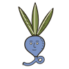

# Samwise



Personal garden organizer: plan garden beds on a grid, track plants and their
care info, and auto-generate care tasks that sync to Google Calendar.

- Design spec: [docs/superpowers/specs/2026-08-19-samwise-design.md](docs/superpowers/specs/2026-08-19-samwise-design.md)
- Implementation plan: [docs/superpowers/plans/2026-08-19-samwise.md](docs/superpowers/plans/2026-08-19-samwise.md)

## Cost

Samwise is a personal project and runs on free tiers only; open source is not
a requirement. What that means for each service:

| Service | Free tier | Watch out for |
| --- | --- | --- |
| Supabase (hosted) | Free plan: 2 projects | Free projects **pause after about a week without activity**; while paused, the daily task top-up doesn't run. Handle this when deploying (e.g. a scheduled ping), or reopen the app to resume. |
| Supabase Storage (plant photos) | 1 GB of files on the free plan | Photos are shrunk to about 1600 px (a few hundred kB) before uploading, so thousands fit. Pictures from Wikipedia and pasted links aren't stored, only shown from their sites. |
| Google sign-in + Calendar API | No charge within quotas | The app stays unverified, so at most 100 users and an "unverified app" warning at sign-in. |
| GitHub + Actions | Free for public repos | Unauthenticated API calls are limited to 60 per hour. |
| Docker Desktop | Free for personal use | Only needed for local development. |
| Frontend hosting | Not chosen yet | Pick a static host with a free tier. |

## Setup

### 1. Prerequisites

| Tool | Used for |
| --- | --- |
| Node.js (LTS) + npm | Angular app, helper scripts |
| Docker Desktop (running) | Required by `npx supabase start` |
| Deno (`winget install DenoLand.Deno`) | Edge Function tests (only from Stage 5) |

You don't need to install the following separately:

- **Angular CLI and Supabase CLI** are project dependencies. Run them with
  `npx ng …` and `npx supabase …` after `npm install`.
- **`psql`** is optional. `npm run db:psql -- -f <file>` (or `-c "<sql>"`)
  uses your local `psql` if it's installed, and otherwise the one inside
  the Supabase database container.

### 2. Google Cloud project

One OAuth client covers both Google sign-in and the Calendar connection.

1. Create a project in the [Google Cloud Console](https://console.cloud.google.com/).
2. **APIs & Services → Library:** enable the **Google Calendar API**.
3. **OAuth consent screen:**
   - User type: External.
   - Branding (required before publishing): app name `Samwise`; home page
     `https://github.com/Kajcin/Samwise`; privacy policy
     `https://github.com/Kajcin/Samwise/blob/main/PRIVACY.md`; authorized domain
     `github.com`. Leave the logo empty, because uploading one triggers Google's brand
     verification. Once the app has its own domain, use that domain instead.
   - Scopes: `email`, `profile`,
     `https://www.googleapis.com/auth/calendar.app.created`. That last one
     lets Samwise create its own "Samwise" calendar and manage events on it,
     with no access to your other calendars.
   - **Publishing status: In production.** `calendar.app.created` is a
     sensitive scope. While the app is in *Testing*, Google expires refresh tokens
     after 7 days, which silently breaks background sync. For personal use you
     don't need Google's verification; you'll see an "unverified app" warning
     when you sign in, and you can click through it.
4. **Credentials → Create OAuth client ID → Web application.** Authorized
   redirect URIs:

   | URI | Purpose |
   | --- | --- |
   | `http://127.0.0.1:54321/auth/v1/callback` | Sign-in, local Supabase |
   | `https://<project-ref>.supabase.co/auth/v1/callback` | Sign-in, hosted Supabase |
   | `http://localhost:4200/settings` | Calendar connect, local app |
   | `https://<your-domain>/settings` | Calendar connect, production app |

   Production hosting isn't chosen yet. Add the last URI once the domain exists.
5. Keep the **client ID** and **client secret** for the next steps.

### 3. Local development

**Supabase Auth config** in `supabase/config.toml`:

```toml
[auth]
site_url = "http://localhost:4200"
additional_redirect_urls = ["http://localhost:4200"]

[auth.external.google]
enabled = true
client_id = "env(SUPABASE_AUTH_EXTERNAL_GOOGLE_CLIENT_ID)"
secret = "env(SUPABASE_AUTH_EXTERNAL_GOOGLE_SECRET)"

# The tasks webhook authenticates with a shared secret, not a JWT.
[functions.calendar-sync]
verify_jwt = false
```

**Env files** (both are gitignored, so never commit them):

`supabase/.env`, read by `config.toml`:

```
SUPABASE_AUTH_EXTERNAL_GOOGLE_CLIENT_ID=<google client id>
SUPABASE_AUTH_EXTERNAL_GOOGLE_SECRET=<google client secret>
```

`supabase/functions/.env`, read by Edge Functions:

```
GOOGLE_CLIENT_ID=<google client id>
GOOGLE_CLIENT_SECRET=<google client secret>
GOOGLE_REDIRECT_URI=http://localhost:4200/settings
CALENDAR_SYNC_WEBHOOK_SECRET=<random string, e.g. `openssl rand -hex 32`>
```

`SUPABASE_URL`, `SUPABASE_ANON_KEY` and `SUPABASE_SERVICE_ROLE_KEY` are
injected into Edge Functions automatically.

**Start the stack:**

```bash
npx supabase start          # prints API URL, anon key, DB URL
npx supabase migration up   # applies new migrations, keeping your data
npm run dev:functions       # serves the Edge Functions (npx supabase functions serve)
```

The first time, `npx supabase db reset` sets the database up (migrations + seed data).
After that, avoid it: a reset deletes everything, including your accounts, beds,
plants, tasks and calendar connection, and there's no undo.

**Point the tasks webhook at the local function.** Run once after
`npx supabase start`, and again after every `db reset`, which wipes Vault:

```bash
npm run dev:calendar-sync
```

This stores the `calendar-sync` URL and `CALENDAR_SYNC_WEBHOOK_SECRET` (read from
`supabase/functions/.env`) as the Vault secrets `calendar_sync_url` and
`calendar_sync_webhook_secret`. Without them, task changes simply aren't synced.

A `db reset` also deletes your calendar connection, while the "Samwise" calendar
stays in your Google account. Connecting again creates a new one, so delete the old
calendar in Google Calendar.

**Angular environment** in `src/environments/environment.development.ts`:
set `supabaseAnonKey` to the anon key printed by `npx supabase start`, and set
`googleClientId` to the Google client ID. The client ID is public; never put
the client secret in the frontend.

```bash
npx ng serve             # http://localhost:4200
```

**Signing in locally without Google.** In development, the login page also
has an email/password form. Create the user once:

```bash
npm run dev:user         # dev@samwise.local / samwise-dev
```

Then sign in with those credentials. `npx supabase db reset` deletes all
users, so run `npm run dev:user` again after a reset.

**SQL tests.** Each file in `supabase/tests/sql` rolls itself back, so it can run
against your database: `npm run db:psql -- -f supabase/tests/sql/<file>`.
`npm run test:sql` runs them all after a reset, so it refuses while the database has
accounts; `npm run test:sql -- --reset` deletes everything and runs them anyway. CI
starts from an empty database. Google sign-in works
locally too, once `supabase/.env` holds the OAuth client from step 2.

### 4. Hosted Supabase (production)

1. Create a Supabase project, then link and push:
   ```bash
   npx supabase link --project-ref <project-ref>
   npx supabase db push
   npx supabase functions deploy connect-calendar
   npx supabase functions deploy disconnect-calendar
   npx supabase functions deploy calendar-sync --no-verify-jwt
   npx supabase functions deploy plant-lookup
   ```
2. **Database → Extensions:** confirm `pg_cron`, `pg_net` and `supabase_vault`
   are enabled. The migrations create the first two, so this is a check.
3. **Authentication → Providers → Google:** enable it and enter the client
   ID and secret.
   **Authentication → Providers → Email:** disable it. Google is the only
   sign-in method in production. The email/password form is hidden in
   production builds, but only disabling the provider stops someone from
   calling the sign-up API directly.
4. **Authentication → URL Configuration:** set Site URL to
   `https://<your-domain>` and add it to the redirect allow-list.
5. **Edge Function secrets:**
   ```bash
   npx supabase secrets set \
     GOOGLE_CLIENT_ID=<id> \
     GOOGLE_CLIENT_SECRET=<secret> \
     GOOGLE_REDIRECT_URI=https://<your-domain>/settings \
     CALENDAR_SYNC_WEBHOOK_SECRET=<new random string>
   ```
6. **Vault secrets.** Run in the SQL editor:
   ```sql
   select vault.create_secret('https://<project-ref>.supabase.co/functions/v1/calendar-sync', 'calendar_sync_url');
   select vault.create_secret('<same value as CALENDAR_SYNC_WEBHOOK_SECRET>', 'calendar_sync_webhook_secret');
   ```
7. **`src/environments/environment.ts`:** fill in the hosted `supabaseUrl`,
   `supabaseAnonKey` and `googleClientId`.

### 5. Frontend hosting

Not decided yet. Any static host with a free tier works: deploy the output of `ng build` and
configure an SPA fallback so every route serves `index.html`. Once you have
the domain, add it to the Google redirect URIs (step 2) and the Supabase URL
configuration (step 4).

## Languages

Samwise speaks English (the default) and Czech.

- **Which language:** before sign-in, the browser's language (Czech if the browser
  prefers Czech over English, otherwise English). On a user's first sign-in that
  language is saved to their account (`user_preferences`), so it follows them to
  other devices. They can change it in **Settings → Language**.
- **Calendar events** are titled in the user's language ("Sklizeň — Rajče"). Changing
  the language re-syncs the upcoming events (a database trigger, migration 0009).
- **Built-in plants** have Czech names and notes in the database (`name_cs`,
  `notes_cs`). Plants you add yourself show what you typed; cloning a built-in plant
  copies its texts in your current language.
- **Adding or changing texts:** edit `src/i18n/en.json` and `src/i18n/cs.json`. Texts use
  ICU message format, e.g. `{count, plural, one {# task} other {# tasks}}`; Czech also
  needs `few` (2-4: "3 úkoly"). The tests fail if the two files have different keys or
  placeholders, if a message doesn't parse, or if the code uses a key that doesn't exist.
  Task names and the place format also live in `supabase/functions/_shared/` for the
  calendar events; a Deno test checks they match the JSON.

## Plant lookup

In the plant catalog, a search can be looked up on the web ("Hledat … na webu"): the
`plant-lookup` Edge Function searches Wikipedia (the user's language first, then the
other) and keeps the results that Wikidata says are plants. Picking one pre-fills the
"Add a custom plant" form with its name, Latin name, a short description credited to
Wikipedia (CC BY-SA 4.0) and a link to the article; the user chooses the sun
requirement and saves. Nothing is saved without that.

- A cultivar Wikipedia doesn't know ("šanta walker's low") is matched to its species or
  genus, and the extra words become the cultivar: *Nepeta racemosa 'Walker's Low'*.
- No API key is needed. Results are cached for 30 days (`plant_lookup_cache`, shared,
  closed to clients). Wikimedia asks API clients for a descriptive User-Agent with a way
  to contact them: set `WIKIMEDIA_USER_AGENT` in `supabase/functions/.env` (and with
  `npx supabase secrets set` when hosted), e.g. `my-garden/1.0 (https://example.com; me@example.com)`.
  Without it, a generic one is sent.
- The article's free main picture comes along, credited (author, licence, link to Wikimedia
  Commons); a plant added from a result gets it as its main photo. Pictures without a known
  licence are left out.
- Samwise never reads other sites (e.g. nursery shops); see `docs/ROADMAP.md`.

## Plant photos

Each plant page shows your photos of the plant (`plant_photos`, migration 0014): the main
one large, the others as thumbnails. You can add photos to your own plants and to the
built-in ones; either way they're visible only to you.

- **Upload:** shrunk in the browser to about 1600 px (JPEG) and stored in the private
  `plant-photos` bucket, in your own folder (`<user id>/<plant id>/…`); shown through signed
  URLs that last an hour. Deleting a photo or the plant deletes the file.
- **Link:** only the address is stored and the picture is shown from its site (nothing is
  copied). Respect the site's terms; if the picture disappears, the page says so.
- **From Wikipedia:** looks the plant up by its Latin name (or name) and offers the free
  pictures found, credited as above.

## Plant types

Each plant can say what kind of plant it is (migration 0015), shown as chips next to its
name and used by the catalog's filters (the **Filters** button):

| Attribute | Values (en / cs) | Per plant |
|---|---|---|
| Life cycle, how it's grown here | annual, biennial, perennial, bulb / letnička, dvouletka, trvalka, cibulovina | one |
| Growth form | herbaceous, subshrub, shrub, tree, climber / bylina, polokeř, keř, strom, popínavka | one |
| Use | vegetable, fruit, herb, ornamental / zelenina, ovoce, bylinka, okrasná | any |

All are optional. Shrubs and trees have no life cycle (in Czech gardening a *trvalka* is a
herbaceous perennial); the form disables it and the database refuses one. Herbaceous plants
get no growth-form chip, since most plants are herbaceous. Within a filter group a plant
matches any picked value; every group with picked values has to match.

The catalog list also shows each plant's sun (icon), watering interval and one season as a
12-month strip: the harvest of vegetables, fruit and herbs (orange), otherwise flowering
(purple). The plant page shows both seasons with the months numbered 1. to 12.

Flowering and harvest are sets of months (migration 0016), not ranges, so a plant can have
two seasons (spinach: spring and autumn). You pick them by clicking months in the edit form.

## Garden beds

A bed starts as a grid of rows × columns. **Upravit** on its card switches it to editing:
a "+" in each gap and next to its edges adds a cell, clicking a cell removes it, and the
bed can be renamed or deleted. So beds can be any shape: an L, or with a path through it.

The database keeps each bed's box (`rows`, `cols`) and its `gaps`, the positions in the box
that aren't part of it (migration 0018). `add_bed_slot` and `remove_bed_slot` keep the box
tight: adding a cell at the top or left moves the plants down or right. Removing a cell
with a plant takes the plant out (after a confirmation), like "Odebrat" in the garden. A
bed can be deleted only when nothing grows in it. Renaming a bed or moving its plants
re-syncs their calendar events, since an event's location names the bed and the cell.

## Care tasks

Tasks come from each plant's care rules. A task belongs to the plant, not to one
planting (migration 0019): several plants of the same kind share one task, shown once with
how many there are and where, e.g. "Dělení trsů — Plicník lékařský (2×: stinný záhonek,
řádek 1, sloupec 1; okrasné bylinky, řádek 3, sloupec 2)". The calendar event is titled
"… (2×)" and lists the places.

- One task per plant, task type and day (or half-month); `task_plantings` lists the
  plantings it covers.
- Repeating rules ("every 21 days") count from the plant's earliest active planting, so
  all its plantings share one schedule. Rules counted from the planting day and yearly
  rules give each planting its own dates; plantings whose dates fall together share them.
- A repeating rule can keep to some months (migration 0021): months picked on a strip
  ("každých 14 dní (duben až květen, září)"), or the plant's harvest or flowering months
  ("každých 7 dní v době sklizně"), followed when you change them on the plant. Within
  months, the count starts again on the 1st of each period (a run of consecutive months,
  also over the new year): every 7 days from July gives 1, 8, 15 … July every year.
  Such rules plan a year ahead, like yearly rules (migration 0022); all-year repeating
  rules plan 90 days ahead and are topped up nightly.
- `sync_plant_tasks()` works the plant's tasks out again when you plant or take a plant
  out, and when its care rules change (migration 0020), and every night adds the next
  ones. Upcoming unfinished tasks follow the rules; completed and past ones stay.
- Taking a plant out detaches it from its unfinished tasks; a task left without plants
  goes. Completed tasks stay as history.

## Security decisions

- **Samwise uses its own calendar.** Connecting creates a "Samwise"
  calendar in your Google account and puts every task there, never in your
  primary calendar. You can hide or recolor it like any other calendar.
  Disconnecting (Settings, after a confirmation) deletes it and revokes
  Samwise's access. If you delete the calendar yourself in Google Calendar,
  syncing stops and Settings offers to reconnect, which creates a new one.
  If you remove Samwise's access in your Google account instead, Samwise
  forgets the tokens but remembers the calendar, so reconnecting reuses it
  and brings its upcoming events up to date.
- **The Calendar refresh token never reaches the browser.** The client has
  no direct access to `calendar_credentials`.
  - `connect-calendar` writes the row with the service role.
  - `disconnect-calendar` deletes the row and revokes the token with Google.
  - The Settings page asks for status through the
    `calendar_connection_status()` RPC (security definer; returns only
    `connected`, `not_connected`, `revoked` or `calendar_deleted`).
- **The tasks webhook authenticates with a shared secret.**
  - `calendar-sync` runs with `verify_jwt = false`.
  - The `tasks` trigger sends an `x-webhook-secret` header read from Vault.
  - The function rejects any request whose header doesn't match
    `CALENDAR_SYNC_WEBHOOK_SECRET`.
  - The trigger only fires for users with a working connection, and only
    for changes the event shows (not when the event id is written back).
- **Per-environment DB settings live in Supabase Vault**
  (`calendar_sync_url`, `calendar_sync_webhook_secret`), not in database
  settings (GUCs).
